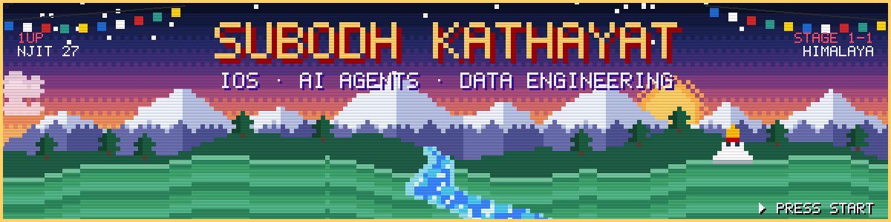

<div align="center">



<a href="https://git.io/typing-svg"></a>

<br/>

<a href="https://neptou.com/"></a>
<a href="https://www.linkedin.com/in/subodh-kathayat-975911219"></a>
<a href="mailto:kathayatsubodh@gmail.com"></a>
<a href="https://apps.apple.com/us/app/gymtrackerapp/id6753898260"></a>

</div>

---

### About me

```swift
struct Subodh {
    let role      = "CS @ NJIT '27 · Building Neptou"
    let builds    = ["iOS apps", "AI agents", "data pipelines"]
    let lastGig   = "Data Engineer Intern @ Medidata (Dassault Systèmes)"
    let shipping  = "fast — most of my products started as 24-hour MVPs"
    let offline   = ["🏸 badminton", "🏃 running", "🏋️ gym", "🎬 cinematography"]
}
```

---

### 🚀 Featured work

<table>
<tr>
<td width="50%" valign="top">

####  [Neptou](https://neptou.com/) — AI travel guide for Nepal
SwiftUI app with location-aware discovery across 80+ destinations, RAG over a human-verified emergency dataset, and Claude + Gemini under the hood.

`1,000+ downloads in 7 days` · `#1 Travel, Nepal App Store` · `National Competition Winner 2026 ($9K)`

<sub>SwiftUI · MapKit · FastAPI · Sentence-Transformers · AWS Bedrock</sub>

</td>
<td width="50%" valign="top">

####  ADIP — Multi-agent integration pipeline
Built at Medidata. Turns meeting notes, JIRA tickets and Slack threads into deployable Airflow code. I owned the code-critique agent and its self-healing pytest loop.

`50% faster integration builds` · `90%+ DAG pass rate`

<sub>Python · AWS Bedrock · Knowledge Bases · Pydantic · Airflow</sub>

</td>
</tr>
<tr>
<td width="50%" valign="top">

#### 🌊 RootLedger — Flood risk platform
HackMIT 2026. Processed 12,066 station-years from 498 NOAA stations and found Nepal's historical 100-year rainfall event now recurs every ~7.75 years.

<sub>Python · pandas · AWS S3 · FastAPI · React/TS · deck.gl · Claude tool-use</sub>

</td>
<td width="50%" valign="top">

####  [GymTracker](https://github.com/subodh10000/GymTrackerApp) — Live on the App Store
Native iOS fitness app with offline-first, AI-personalized workouts and real-time sync.

<sub>Swift · SwiftUI · Firestore · Cloud Functions</sub>

</td>
</tr>
<tr>
<td width="50%" valign="top">

####  [Atomica](https://github.com/subodh10000/Atomica-App-AI-powered-habit-maker-app-) — HackPrinceton 2025
AI habit app that turns your daily rhythm into a personalized 7-day plan.

<sub>Swift · SwiftUI · Gemini API</sub>

</td>
<td width="50%" valign="top">

####  [CaughtIn4K](https://github.com/subodh10000/Caughtin4KNJIT) — 🥉 NJIT Claude AI Hackathon
Chrome extension that flags scam emails in Gmail using Claude.

<sub>JavaScript · Chrome Extensions API · Claude API</sub>

</td>
</tr>
</table>

---

### 🛠️ Tech stack

<div align="center">

**Mobile**<br/>


**AI / Backend**<br/>


**Data**<br/>


**Web & Tools**<br/>


</div>

---

### Highlights

- 🥇 **Code for Impact** — national winner, U.S. Embassy Nepal–supported accelerator — Neptou ($9,000)
- 🥇 **National Hackathon Competition Winner Code for change 2022** 
- 🥉 **NJIT Claude AI Hackathon** · built at **Columbia DivHacks** ·  **HackPrinceton** & **HackMIT**  
- 🌱 Founder of **Aasha Ka Paila** — 15+ community projects supporting 600+ families - A Non-profit in Nepal
- 🇳🇵 Former President, **NJIT Nepali Student Association**

---

<div align="center">

**Currently:** shipping Neptou · building AI agents · open to **Full-time 2027 SWE / iOS / AI roles**


</div>